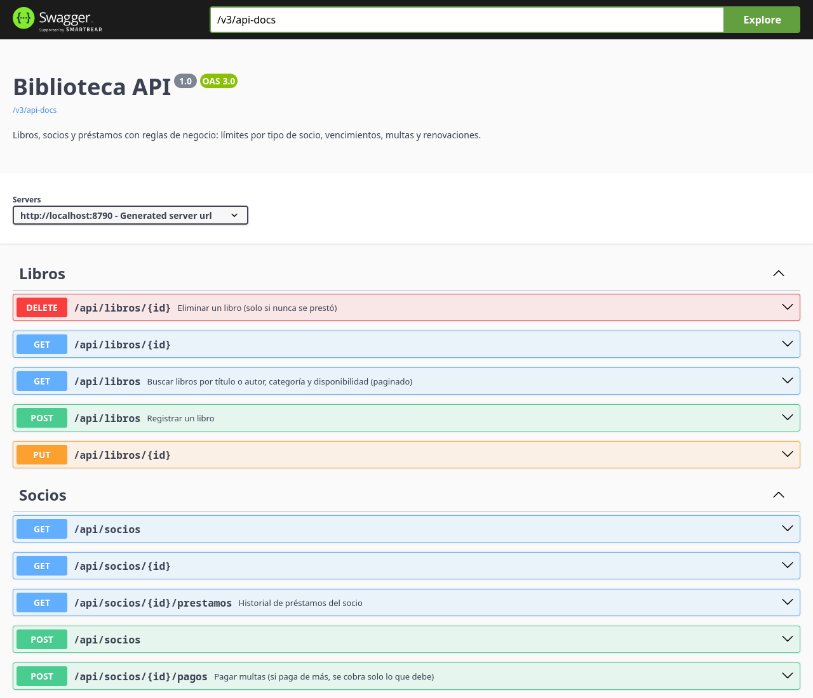

<div align="center">



### Una API REST pequeña pero completa: reglas de negocio de verdad, errores claros, pruebas y Docker.


<a href="https://github.com/NeckHurtttt/biblioteca-api/actions/workflows/ci.yml"></a>


</div>

## 📚 Qué hace

Gestiona una biblioteca universitaria: **libros**, **socios** (estudiantes y docentes) y **préstamos**.
Lo interesante no es el CRUD sino las **reglas de negocio** y cómo se prueban:

| Regla | Detalle |
|---|---|
| 👩‍🎓 Límite por tipo de socio | Estudiante: hasta **3** libros por **7 días**. Docente: hasta **5** por **14 días**. |
| 📕 Disponibilidad | Cada préstamo descuenta un ejemplar; no se presta si no quedan, ni dos copias del mismo libro al mismo socio. |
| ⏰ Vencidos | Un socio con un libro vencido no puede pedir otro hasta devolverlo. |
| 💸 Multas | Al devolver tarde se cobra **Bs 2 por día** de atraso; con deuda no hay préstamos hasta pagar. |
| 🔁 Renovación | Una sola vez y solo si no está vencido. Suma otro plazo completo. |
| 🗑️ Integridad | No se borra un libro con historial ni se bajan los ejemplares por debajo de los prestados. |

<div align="center"></div>

## 🔌 Endpoints

| Método | Ruta | Qué hace |
|---|---|---|
| `GET` | `/api/libros?q=&categoria=&disponibles=&page=&size=&sort=` | Buscar libros (paginado) |
| `GET` `POST` `PUT` `DELETE` | `/api/libros/{id}` | CRUD de libros |
| `GET` `POST` | `/api/socios`, `/api/socios/{id}` | Socios |
| `GET` | `/api/socios/{id}/prestamos` | Historial del socio |
| `POST` | `/api/socios/{id}/pagos` | Pagar multas |
| `POST` | `/api/prestamos` | Prestar `{ "libroId": 1, "socioId": 1 }` |
| `POST` | `/api/prestamos/{id}/devolucion` | Devolver (calcula la multa) |
| `POST` | `/api/prestamos/{id}/renovacion` | Renovar |
| `GET` | `/api/prestamos?vencidos=true` | Préstamos activos o solo vencidos |
| `GET` | `/api/estadisticas` | Activos, vencidos y los 5 libros más pedidos |

### Ejemplo

```console
$ curl -X POST localhost:8080/api/prestamos -H 'Content-Type: application/json' -d '{"libroId":1,"socioId":1}'
{"id":1,"titulo":"Introduction to Algorithms","socio":"Ana Gutiérrez","fechaPrestamo":"2026-11-12",
 "fechaLimite":"2026-11-19","renovaciones":0,"multa":0,"estado":"ACTIVO", ...}

$ curl -X POST localhost:8080/api/prestamos -H 'Content-Type: application/json' -d '{"libroId":4,"socioId":2}'
{"type":"https://github.com/NeckHurtttt/biblioteca-api#sin-ejemplares","title":"Regla de negocio","status":409,
 "detail":"No quedan ejemplares disponibles de «Design Patterns»","codigo":"sin-ejemplares"}
```

Los errores siguen **RFC 7807** (`application/problem+json`): 404 si no existe, 400 con los campos inválidos y 409 con un `codigo` por cada regla.

## ▶️ Correr

```sh
./mvnw spring-boot:run            # H2 en memoria con datos de ejemplo → http://localhost:8080/swagger-ui.html
./mvnw verify                     # 11 pruebas de integración
docker compose up --build         # API + PostgreSQL 16
```

## 🧱 Diseño

```
src/main/java/bo/upsa/biblioteca
├── libro/      Libro, repositorio con búsqueda JPQL paginada, DTOs con validación, controlador
├── socio/      Socio, TipoSocio (límites y plazos en el enum), pagos de multas
├── prestamo/   Prestamo, PrestamoService (todas las reglas), controlador y estadísticas
└── common/     Excepciones de negocio y ManejadorErrores (RFC 7807)
```

- **Reglas en el servicio**, entidades con métodos de dominio (`prestarEjemplar`, `renovar`, `sumarMulta`), DTOs como `record`.
- **Reloj inyectable** (`Clock`): las pruebas adelantan el tiempo para probar vencimientos, multas y renovaciones sin esperar días.
- `@EntityGraph` para traer libro y socio con el préstamo (sin N+1 ni `LazyInitializationException`, con `open-in-view` apagado).
- Perfil `postgres` para producción y H2 para desarrollo. CI con GitHub Actions. Imagen Docker en dos etapas con usuario sin privilegios.

## 🌎 English

A small but complete **Spring Boot 3 / Java 21** REST API for a university library: books, members (students and teachers)
and loans with real business rules: per-member limits and loan periods, availability, overdue blocking, **Bs 2/day fines**,
one-time renewals and referential integrity. Errors follow **RFC 7807**, there is Swagger UI, 11 MockMvc integration tests
using an injectable `Clock` to time-travel, Docker Compose with PostgreSQL and GitHub Actions CI.

<div align="center">

**Hecho por [NeckHurtttt](https://github.com/NeckHurtttt)** · Programación · UPSA · Santa Cruz, Bolivia 🇧🇴

<sub>prestar · devolver · multar · repetir</sub>

</div>
